<p align="center">
  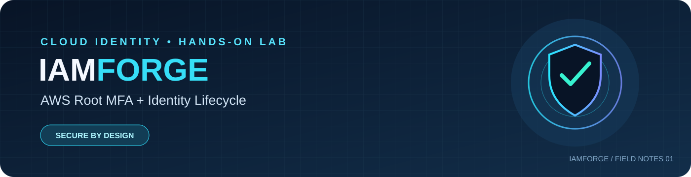
</p>

<p align="center"><strong>Two practical tracks. One identity-security story.</strong><br/>Root account hardening · Virtual MFA · IAM user provisioning · Permission review</p>

---

## FIELD NOTE / 00 — The mission

**IAMForge** is a hands-on AWS identity-security lab documented with console screenshots and practical observations. It follows two separate workflows: hardening the AWS root sign-in with MFA, then creating a separate IAM user and reviewing the permissions granted to that identity.

The goal is to record **what changed, what was verified, and what still needs attention**—not simply to collect screenshots.

> **Public-repository safety:** the authenticator QR/seed area has been covered in the published setup image. Never commit passwords, live OTPs, MFA QR codes, TOTP seed keys, access keys, full account identifiers, or private sign-in details. Review every image before publishing.

## NAVIGATION / 01 — The two tracks

<p align="center">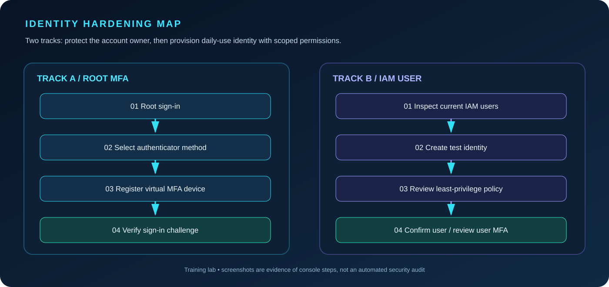</p>

| Track | Evidence captured | Security takeaway |
|---|---|---|
| **A — Root MFA** | Sign-in, MFA method selection, authenticator enrollment, device assignment, MFA challenge, console access | Protect the highest-privilege identity and test that the second factor is requested at sign-in. |
| **B — IAM user lifecycle** | Initial users list, user creation, permission selection, review, success, final users list | Use a separate daily-use identity and review the access granted to it. |

## TRACK A / 02 — Root account MFA hardening

### A1. Enter the root sign-in flow

The first two screens capture the root sign-in flow and the user-type selection. Identity fields have been obscured in the shared screenshots.

<p align="center">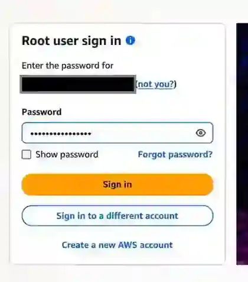</p>
<p align="center">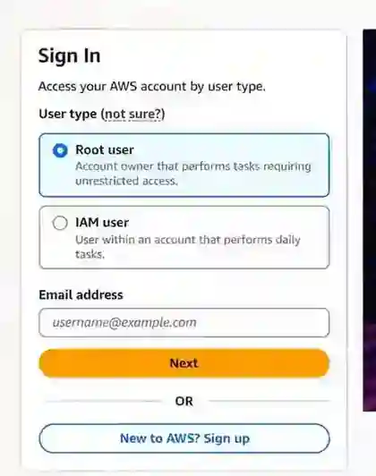</p>

### A2. Review the IAM security posture

The supplied dashboard shows the root-user MFA check in a passing state and no active root access keys. This is the **post-configuration state** in the captured evidence; this guide does not claim a measured before-and-after result.

<p align="center">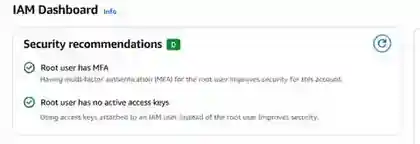</p>

### A3. Choose the MFA method

The console offers multiple MFA methods. This lab follows the authenticator-app route for a virtual time-based code.

<p align="center">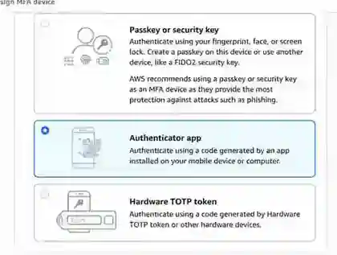</p>

### A4. Enroll the authenticator app

The enrollment screen describes scanning the QR or using a secret key. The shared seed is sensitive, so the QR block is covered in this repository copy. In the real setup, keep the seed private and enter the required consecutive codes only in the AWS console.

<p align="center">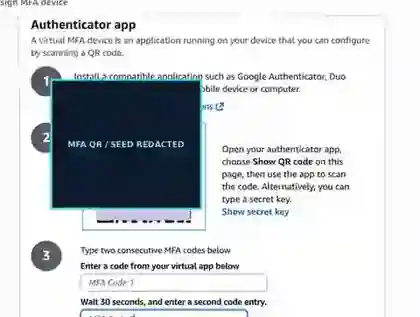</p>

### A5. Confirm assignment and test sign-in

The security-credentials screen contains an **MFA device assigned** confirmation. A later screen shows the MFA challenge during sign-in, and the console-home image records that the workflow reached the console.

<p align="center">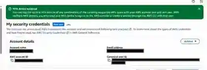</p>
<p align="center">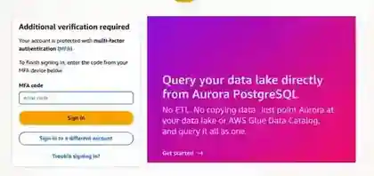</p>
<p align="center">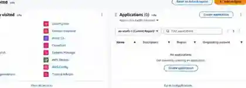</p>

### Track A / Verification record

- [x] Root-user sign-in flow captured.
- [x] Authenticator-app method selected.
- [x] MFA device assignment confirmation captured.
- [x] MFA sign-in challenge captured.
- [x] Console home reached in the supplied evidence.
- [x] QR/seed block covered in the published enrollment image.

## TRACK B / 03 — IAM user lifecycle

### B1. Establish the starting point

The initial users page shows no IAM users before the test identity is created.

<p align="center">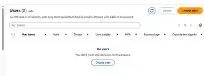</p>

### B2. Create the separate user

The captured flow creates a separate IAM identity rather than using the root user for everyday tasks.

<p align="center">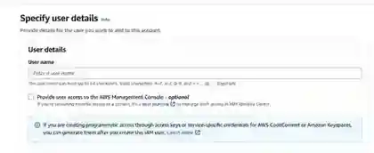</p>

### B3. Review the permission choice

The permission workflow uses a managed policy path. The review screen identifies **AmazonEC2ReadOnlyAccess**. Read-only access is narrower than administrative access, but it should still be granted only when needed.

<p align="center">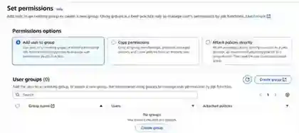</p>
<p align="center">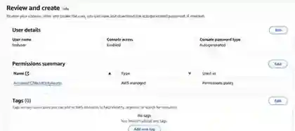</p>

### B4. Confirm creation and inspect the list

The success screen confirms user creation, and the final users-list screenshot shows the created identity.

<p align="center">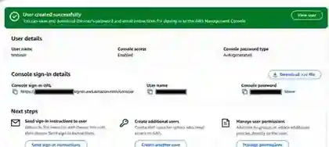</p>
<p align="center">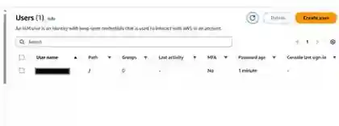</p>

### Track B / Verification record

- [x] Empty users list captured before creation.
- [x] User creation flow captured.
- [x] Permission selection and review captured.
- [x] User creation success captured.
- [ ] **Follow-up:** configure MFA for the IAM user if console access is enabled and independently verify its MFA status. One captured users-list screenshot displayed **MFA: No**; root-user MFA does not automatically enable MFA for every IAM user.
- [ ] **Follow-up:** review whether console-password access is necessary and keep permissions limited to the required work.

## OBSERVATIONS / 04 — What this lab demonstrates

1. **Root account protection:** evidence shows root MFA enabled and an MFA-device assignment confirmation.
2. **Authentication enforcement:** the sign-in sequence includes a secondary MFA challenge.
3. **Identity separation:** a distinct IAM user was created for non-root activity.
4. **Permission review:** the new identity's review screen shows the EC2 read-only managed policy.
5. **Remaining hardening:** the IAM user's MFA status must be checked separately; the supplied evidence showed it was not yet enabled for that identity.

## REPRODUCTION NOTES / 05

This is a console walkthrough, not a Terraform/CloudFormation deployment and not an automated compliance scan. AWS console labels can change. For a real account, follow your organization's identity policy, use least-privilege permissions, and verify final settings from the relevant user's security-credentials page.

### Final-state checklist

- [ ] Root MFA is assigned and a fresh sign-in requests an MFA code.
- [ ] No root access keys exist unless a documented exception requires them.
- [ ] The separate IAM user has only required permissions.
- [ ] IAM-user MFA is enabled where applicable and verified independently.
- [ ] Recovery methods are stored privately and access to them is controlled.
- [ ] Every screenshot has been checked for secrets and personal identifiers.

## REPOSITORY MAP / 06

```text
iamforge-aws/
├── README.md
├── iamforge-banner.svg          # original project identity
├── identity-hardening-map.svg   # original workflow diagram
├── assets/
│   ├── 01-root-signin.webp
│   ├── 02-signin-account-type.webp
│   ├── 03-iam-dashboard-mfa-enabled.webp
│   ├── 04-mfa-device-method.webp
│   ├── 05-authenticator-enrollment-redacted.webp
│   ├── 06-mfa-device-assigned.webp
│   ├── 07-mfa-signin-challenge.webp
│   ├── 08-console-home.webp
│   ├── 09-iam-users-empty.webp
│   ├── 10-create-iam-user.webp
│   ├── 11-assign-user-permissions.webp
│   ├── 12-review-user-permissions.webp
│   ├── 13-iam-user-created.webp
│   └── 14-iam-user-list.webp
└── LICENSE
```

## SAFETY / 07 — Scope and disclaimer

This repository records an educational AWS console exercise. It does not claim independent audit certification or guarantee compliance. The account owner is responsible for keeping credentials private and securing the account. Do not publish live MFA seed material or another person's account details.

---

<p align="center"><strong>IAMFORGE</strong><br/>Identity first. Least privilege. Evidence over assumption.</p>
